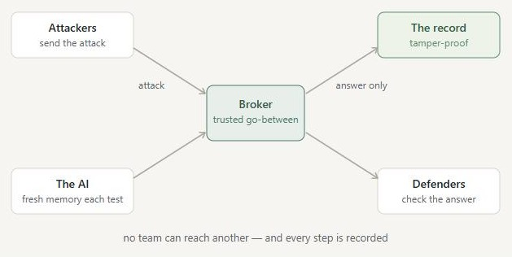

# sealed

[](https://github.com/ChethanValukuru/sealed-manali-/actions/workflows/ci.yml)

**Test an AI safely — and trust the result.**

To check whether an AI is safe, one team tries to trick it (the **attackers**) while
another team defends it (the **defenders**), at the same time. The catch: if all three
— attackers, defenders, and the AI — share one space, they can peek at each other and
the AI gets confused between tests, so the result can't be trusted.

**sealed** keeps each one in its own locked room, routes everything through one trusted
go-between, gives the AI a fresh memory for every test, and keeps a record no one can
secretly change — then issues a **signed proof** that the test was sound.

---

## How it works

Everything flows through one trusted **broker** in the middle. No team ever talks to
another directly, the defenders only ever see the AI's answer (never the raw attack
until the test ends), and every step is written to a tamper-proof record.



- **Separate rooms** — each team is isolated (separate networks, locked-down containers) and can't reach, see, or read the others.
- **A trusted go-between** — the broker mediates all traffic and enforces who may see what.
- **Fresh AI each test** — the model starts every test with a blank memory, so one test can't contaminate the next.
- **Tamper-proof record** — every action is hash-chained and digitally signed; any edit is caught.
- **A proof you can check** — each finding comes with a signed certificate that the test was sound, published to a tamper-evident **transparency ledger** that **independent witnesses co-sign** (like Certificate Transparency for AI-safety tests), so not even sealed's own audit service can rewrite history. Anyone can verify it **in their own browser**, trusting nothing — [`web/verify.html`](web/verify.html).

---

## Run it

The project ships a stand-in AI model, so you don't need a GPU or any paid key.

### Option 1 — one click (Windows, no Docker)

Needs Python 3.11+ and Node.js, nothing else.

```
Double-click START-DEMO.bat
```

It starts the system, serves the web pages, waits until everything is healthy, and opens
the live console in your browser. Two console windows appear — leave them open, close
them when you're done. By hand instead:

```powershell
python run-local.py      # the whole system, in-process (wait for READY)
node serve-web.js        # serves web/ on http://localhost:8080
```

Then open <http://localhost:8080/console.html>. The full walkthrough is in
[`docs/DEMO.md`](docs/DEMO.md); `JUDGE-DEMO.bat` is a scripted, narrated version of the
same run for a judging table.

### Option 2 — the full containerized system (Linux with Docker or Podman)

```bash
git clone https://github.com/ChethanValukuru/sealed-manali-.git
cd sealed-manali-/sealed
cp .env.example .env
make up            # build and start everything
make ps            # all parts should show "healthy"
```

Then try it:

```bash
make demo-naive    # BEFORE: the insecure setup — the attack leaks
make demo-secure   # AFTER:  the same attack, fully contained + recorded
make test          # the automated objective proofs
make verify-audit  # the record is intact
make demo-tamper   # secretly edits the record — the checker catches it
make down          # stop everything
```

Optional: `make fetch-datasets` to replay the real **AdvBench** benchmark attacks, or
`make up-ollama` to run against a real AI model instead of the stand-in.

### Option 3 — the container-free harness (any OS with Python)

```bash
pip install -r sealed/tools/requirements.txt
python sealed/tools/local_e2e.py     # isolation, audit, contamination, latency checks
```

This is what the `harness` job in CI runs on every push.

### Option 4 — just the website

```bash
cd web
python -m http.server 8080           # then open http://localhost:8080
```

Three pages: a one-screen landing page, a live console (run a test, get the signed proof,
try to tamper with it, download a findings report), and a **zero-trust proof verifier**
(`verify.html`) that re-checks a proof's signatures and Merkle inclusion entirely in your
browser, with a live tamper demo. It deploys on **Vercel** with
**Root Directory = `web`** and framework preset **Other**. To use the live console
against a running system, start Option 1 or 2 and press **Connect**.

---

## What's in here

| Path | What it is |
|---|---|
| [`sealed/`](sealed/) | the system itself — broker, isolation, audit chain, transparency ledger, witnesses, tests |
| [`web/`](web/) | the website — landing page, live console, zero-trust proof verifier |
| [`run-local.py`](run-local.py) | runs the whole stack in-process on one machine, no Docker |
| [`serve-web.js`](serve-web.js) | zero-dependency static server for `web/` |
| `START-DEMO.bat` / `JUDGE-DEMO.bat` | one-click demo launcher, and the narrated judging run |
| [`docs/`](docs/) | demo script, pitch sheet, market research, accuracy report, explainer |
| [`sealed/THREAT_MODEL.md`](sealed/THREAT_MODEL.md) | what it protects against — and, honestly, what it doesn't |
| [`sealed/docs/REFERENCES.md`](sealed/docs/REFERENCES.md) | how it maps to the OWASP Top 10 for LLM Applications (2025) |

### Inside `sealed/`

| Path | What it is |
|---|---|
| `broker/` | the trusted go-between: policy, capability tokens, timing, audit client |
| `audit/` | hash-chained log, Merkle tree, attestations, transparency ledger, tamper demo |
| `witness/` | independent co-signers for the ledger checkpoints |
| `monitor/` | runtime watchdog over the sealed enclave |
| `tenants/` | the three isolated rooms: `red/` attackers, `blue/` defenders, `model/` the AI |
| `isolation/` | nftables default-deny, seccomp profile, cgroups |
| `datasets/` | the attack corpus and the AdvBench / JailbreakBench fetchers |
| `tools/` | container-free harness, judge runner, report builders |
| `tests/` | the objective proofs (isolation, audit, contamination, access, latency) |

Every change is automatically tested on a real Linux machine — containerized isolation
proofs, audit-integrity and tamper detection, plus an optional real-Ollama generation run
(see the CI badge above).

*Built for Hack in Hills '26 · Track 04 (Bayora).*
