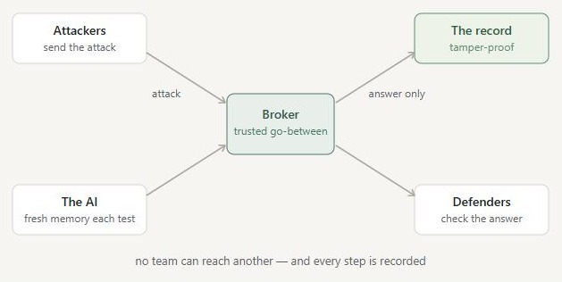

# sealed

[](https://github.com/ChethanValukuru/sealed-manali-/actions/workflows/ci.yml)

**Test an AI safely — and trust the result.**

To check whether an AI is safe, one team tries to trick it (the **attackers**) while
another team defends it (the **defenders**), at the same time. The catch: if all three
— attackers, defenders, and the AI — share one space, they can peek at each other and
the AI gets confused between tests, so the result can’t be trusted.

**sealed** keeps each one in its own locked room, routes everything through one trusted
go-between, gives the AI a fresh memory for every test, and keeps a record no one can
secretly change — then issues a **signed proof** that the test was sound.

---

## How it works

Everything flows through one trusted **broker** in the middle. No team ever talks to
another directly, the defenders only ever see the AI’s answer (never the raw attack
until the test ends), and every step is written to a tamper-proof record.



- **Separate rooms** — each team is isolated (separate networks, locked-down containers) and can’t reach, see, or read the others.
- **A trusted go-between** — the broker mediates all traffic and enforces who may see what.
- **Fresh AI each test** — the model starts every test with a blank memory, so one test can’t contaminate the next.
- **Tamper-proof record** — every action is hash-chained and digitally signed; any edit is caught.
- **A proof you can check** — each finding comes with a signed certificate that the test was sound; anyone can verify it.

---

## How to run it

Pick whichever fits. The project ships a stand-in AI model, so you don’t need a GPU or any paid key.

### Option 1 — the full system (Linux with Docker or Podman)

```bash
git clone https://github.com/ChethanValukuru/sealed-manali-.git
cd sealed-manali-/sealed
cp .env.example .env
make up            # build and start everything
make ps            # all parts should show "healthy"
```

Then try it:

```bash
make demo-naive    # BEFORE: the insecure setup — the attack leaks
make demo-secure   # AFTER:  the same attack, fully contained + recorded
make test          # run all the automated checks (should all pass)
make verify-audit  # the record is intact
make demo-tamper   # secretly edits the record — the checker catches it
make down          # stop everything
```

Optional: `make fetch-datasets` to replay the real **AdvBench** benchmark attacks, or
`make up-ollama` to run against a real AI model instead of the stand-in.

### Option 2 — a quick check (any computer with Python, no Docker)

```bash
git clone https://github.com/ChethanValukuru/sealed-manali-.git
cd sealed-manali-
pip install -r sealed/tools/requirements.txt
python sealed/tools/local_e2e.py      # runs everything locally -> "19/19 checks passed"
```

### Option 3 — the website

A simple, plain-language site: an overview, a 1-minute animated walkthrough, and a live
console (run a test, get the signed proof, download a findings report).

```bash
cd web
python -m http.server 8080            # then open http://localhost:8080
```

It deploys on **Vercel** with **Root Directory = `web`** and framework preset **Other**.
To use the live console, start the system (Option 1) and press **Connect**.

---

## What’s in here

| Path | What it is |
|---|---|
| [`sealed/`](sealed/) | the system itself (the broker, isolation, tamper-proof record, tests) |
| [`web/`](web/) | the website (overview, walkthrough, live console) |
| [`sealed/THREAT_MODEL.md`](sealed/THREAT_MODEL.md) | what it protects against — and, honestly, what it doesn’t |
| [`sealed/docs/REFERENCES.md`](sealed/docs/REFERENCES.md) | how it maps to the OWASP Top 10 for LLM Applications (2025) |

Every change is automatically tested on a real Linux machine (see the CI badge above).

*Built for Hack in Hills ’26 · Track 04 (Bayora).*
